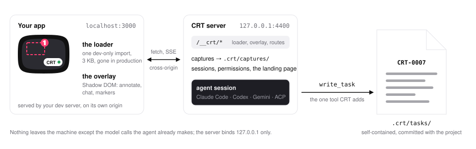

# How it works

The pieces — your app with the loader and the overlay, the CRT server on `127.0.0.1:4400`, the agent session and its `write_task` tool — and how they talk in embedded and proxy mode, in the CRT browser and through the extension, where a run writes, what the session may do, and what leaves the machine (nothing but the agent's own model calls). Back to the [README](../README.md).

<picture>
  <source media="(prefers-color-scheme: dark)" srcset="images/architecture-dark.svg">
  
</picture>

```
Browser tab  http://localhost:3000 ──── your app, on its own origin, served by your dev server
   ├─ CRT loader (the snippet: one dev-only import, or a <script> tag)
   │     installs the console/network hooks, then appends <script src="http://localhost:4400/__crt/overlay.js" defer>
   └─ CRT overlay (Shadow DOM) ──── /__crt/* cross-origin (loopback CORS) ──┐
                                                                            ▼
crt server (Node, 127.0.0.1:4400 only)                       ┌──────────────────────┐
   /__crt/loader.js, /__crt/overlay.js, /__crt/health …      │ agent session        │
   capture store  .crt/captures/ → .crt/tasks/assets/        │ Claude Code (SDK) or │
   task store     .crt/tasks/*.md + README index             │ Codex CLI            │
   session manager ──────────────────────────────────────────▶ write_task tool     │
   landing page at / (proxy mode: your app, proxied)         └──────────────────────┘
```

- **Embedded mode** (`crt`). The CRT server is the agent host: it binds `127.0.0.1:4400`, serves the loader, the overlay and the `/__crt/*` API, and proxies nothing — `http://localhost:4400/` is a landing page that says so and links to your app. Your app's own dev server serves your app; the one dev-only line in it loads the loader from CRT, the loader installs the console/network hooks and appends the overlay script from the running server, and the overlay talks to the API cross-origin. The server allows that only for `localhost`, `*.localhost`, `127.0.0.1` and `[::1]` origins (any port, http or https); every other origin gets no CORS headers and its preflight is refused. `crt` finds your app the way proxy mode does (positional, `--target`, the remembered or configured `target`, then the probed ports) but only to open it and print it; it never waits for it.
- **Proxy mode** (`crt proxy`). The same server, in front of your dev server: it forwards everything, rewrites `text/html` responses to inject the early hook and the deferred overlay script before `</head>`, pipes WebSocket upgrades through untouched so Next.js and Vite HMR keep working, and you browse `http://localhost:4400`. Every CRT route lives under `/__crt/`; nothing else is added to your app. See [Proxy mode](integration.md#proxy-mode).
- **The CRT browser** (`crt` in an app without the integration, or `crt browse`). The same embedded server, and a Chrome or Edge process CRT starts itself with a profile per project under the CRT home. CRT drives it over the DevTools protocol on a private pipe between the two processes — no debug port is opened — to do two things: add the loader to every page before the page's own scripts run, and remove the `Content-Security-Policy` header from documents on loopback hosts in that window, so the app's policy cannot refuse the overlay. Nothing is added to the app, and no other site is touched. While you review in that window the app's own policy is therefore not enforced, so a violation the app would report elsewhere does not show there. See [Reviewing an app](review.md).
- **The extension** (`crt extension`, then the toolbar button on any site). A Manifest V3 extension for your own Chrome or Edge, and the only way in that leaves the app, its URL and its security policy alone. It has three parts. A small *probe* runs in the page's own world from the first moment of the load: the console and network hooks and the framework lookups, which only the page's world can see. The *overlay* — the same source as everywhere else — runs in the extension's isolated world inside a closed shadow root, where no page script can reach it; it asks the probe for the logs and component names when it captures and treats the answers as data. The extension's *service worker* is the only thing that talks to the CRT server: every API call, the session's event stream and the tab screenshot go through it, so the page's `connect-src` is never asked and the server sees `Origin: chrome-extension://…` on a loopback request it already accepts. Nothing runs on a site until you turn CRT on there with the toolbar button; the grant is for that one site and is given back when you turn it off. The overlay ships inside the extension (the browser forbids remote code), so the extension mounts only against a server of its own major.minor. The server prints `crt: overlay loaded in the browser (the extension, on <origin>)` on the first mount and counts them in health's `overlay.extension`. More: [extension.md](extension.md).
- **Where a run writes.** A project with `.crt/tasks/` is *set up*: captures and task files go under its `.crt/`. Any other project is a *guest*, and so is a set-up one started with `--review`: everything goes under the CRT home (`~/.crt`, or `CRT_HOME`) instead — `reviews/<project>/<review>/` holds the items `R-NN` with their screenshots, and the project's working tree is not written to. `crt handoff` is what moves the kept items into the project, as `.crt/tasks/**` on a branch of their own.
- **Overlay.** One framework-free bundle (~85 KB, 28 KB gzipped) rendered inside a Shadow DOM host so your CSS and its CSS never meet, always fetched from the running server so it can never be a different version than the server. It is idle until you open it. `window.__crt` is its only global — a debugging/test surface (`window.__crt.loader` is the loader's: its origin and a `retry()`).
- **Intake session.** Send starts a real Claude Code session through `@anthropic-ai/claude-agent-sdk` with `cwd` = your project root (the nearest ancestor with `.git`, else the launch directory), `settingSources` user + project + local, and the Claude Code system prompt with the intake instructions appended (the same text as `/crt:intake`). The first message is the capture summary, your notes, the path to `capture.json` and the screenshots as images. The panel shows only your words for it — your note, or one line per annotation — and folds the rest behind a `Capture` pill; what the agent receives is unchanged. The process boots while the page is still being rasterised so the panel is live within a few seconds. Text streams over SSE; a `write_task` tool exposed by the server allocates the ID, renders the file, moves the assets and regenerates the index, so the file can never drift from the format. When Claude's message ends on the proposal's closing line, the panel folds it to its first paragraph and a `Definition of done · N items` pill that opens the full checklist, and the closing line becomes the **Accept** button; the full text stays in the transcript.
- **Permissions.** The session runs in Claude Code's `default` mode. Reads, searches, read-only `git` commands, CRT's own tool and writes under `.crt/` are allowed silently; `WebFetch`/`WebSearch` are denied; everything else prompts in the panel and is denied after five minutes without an answer. Intake does not modify source code; that is `/crt:next`'s job, in a normal session you can watch.
- **Privacy.** At runtime the server writes only under `.crt/` and the CRT home (and the OS temp dir), and never under the root of a project that is not set up; `crt init` is the one command that writes elsewhere in a project, and it names every file first. Nothing leaves the machine except the model calls the agent already makes — and, when you run `crt handoff` and confirm its plan, the `git push` and `gh pr create` (or, with `--to github`, `gh issue create` and the push of the screenshots' branch) it then runs with your own credentials to your own remote, and whatever a destination module or command you named in the config yourself does ([destinations.md › Trust](destinations.md#trust)): the loader talks to `127.0.0.1` only, and only from a page on a loopback hostname. Embedded mode changes nothing about what a page can reach: your app's own scripts run on your app's origin and can call the CRT API cross-origin exactly as the overlay does (loopback CORS) — the same capability page scripts had on the proxied origin in proxy mode. There is no new route and no new page-writable key; `/__crt/internal/*` refuses any request carrying an `Origin` header, and the loader carries no token. No telemetry.
