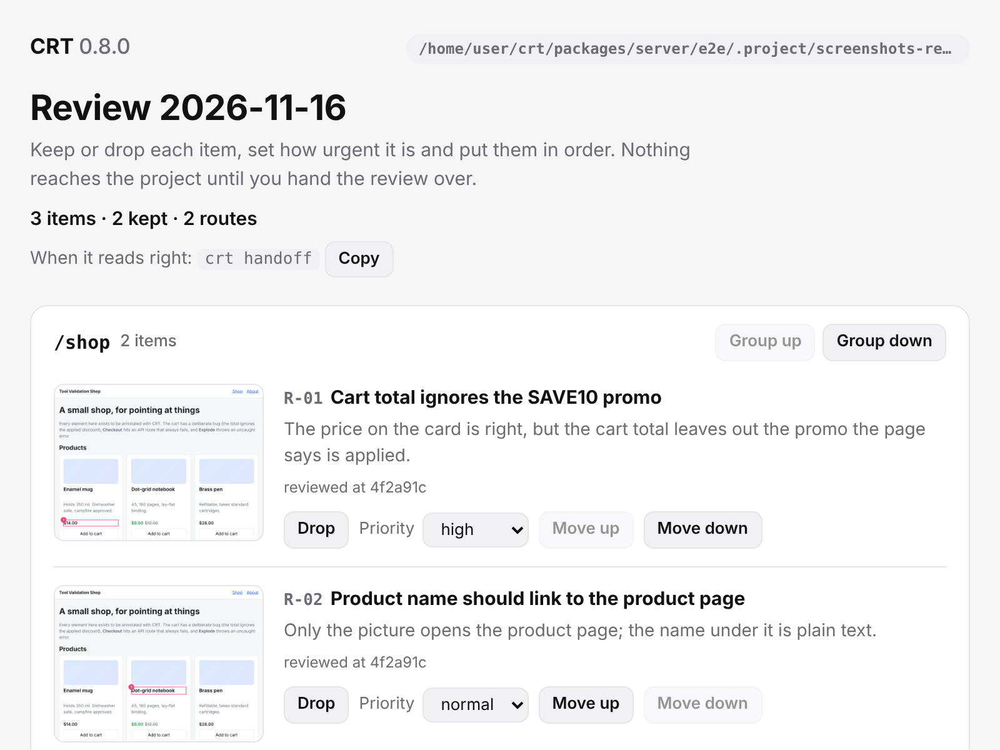

# Reviewing an app

How to review an app with nothing added to it — the browser CRT opens itself, the guest start that writes nothing into the project, the review your feedback is kept in, its page, and `crt handoff`, which sends the kept items to the project as one branch and one pull request. Back to the [README](../README.md).

```bash
# reviewing an app, nothing added to it
npm run dev                       # the app's dev server, its own URL
npx claude-review-tool            # CRT server on :4400; a browser window opens on the app with the CRT button
crt review                        # the review on one page: keep, drop, prioritise, order
crt handoff                       # the kept items → the project, as one branch and one pull request
```

Nothing is installed in the app, no line is added to its source, and `git status` in the project stays empty until the hand-over. The four steps below are what each command does; every flag is in [cli.md](cli.md).

## 1. The CRT browser

When the app carries no CRT integration, `crt` starts a Chrome or Edge window itself and puts the CRT button on the app's own URL (`http://localhost:3000`, not a proxied copy). It does that over the DevTools protocol, on a private pipe between CRT and that one browser process: the loader is added to every page the window opens before the page's own scripts run, so the errors the app logs while it starts are in your captures too.

- **Which browser.** Chrome, then Edge, then Chromium, from their usual install locations. `"browser": { "command": ["<path>", "<arg>", …] }` in `.crt/config.local.json` names another. `crt doctor`'s `browser` row says which one CRT found.
- **Its own profile.** The window uses a profile under `~/.crt/browser/<project>`, so it shares no cookies, extensions or history with your everyday browser, and you sign in to the app once per project.
- **The app's security policy.** A strict `Content-Security-Policy` would block the overlay, so CRT removes that header from the documents of loopback pages (`localhost`, `127.0.0.1`) in this window, and from nothing else. While you use the CRT browser you therefore do not see the app's own policy violations; the integration and `crt proxy` leave the policy in force when you need it enforced.
- **No debug port.** Nothing listens on the network for the browser; closing the window leaves CRT running (`crt browse` opens it again), and stopping CRT closes the window.

What `crt` opens is decided once per start and named on the ready line:

| The app | `crt` opens | Ready line |
|---|---|---|
| carries the integration ([integration.md](integration.md)) | your default browser, as before | `(embedded; …)` |
| has no integration, and Chrome or Edge is installed | the CRT browser | `(embedded, CRT browser; …)` |
| has neither | nothing, and says so: ``crt: no CRT integration in this app and no Chrome or Edge found — run `crt proxy`, or set browser.command in .crt/config.local.json`` | `(embedded; …)` |

`crt browse` asks for the CRT browser whatever the app carries; `crt proxy` is unchanged; `--no-open` opens nothing.

## 2. The guest start

In a project without `.crt/tasks/`, `crt` asks nothing and sets nothing up. It says so once and starts:

```
crt: C:\my-app is not set up for CRT — keeping this review in C:\Users\me\.crt\reviews\my-app-3fa9c1 (nothing is written to the project; `crt init` adopts CRT here).
CRT ready at http://localhost:4400 for http://localhost:3000 (embedded, CRT browser, guest; project: C:\my-app, review 2026-11-16: 0 items, provider: claude (default), login: ok)
```

Everything CRT would have written under `.crt/` goes under the CRT home instead (`~/.crt`, or `CRT_HOME`): the captures, the task files, the remembered target and the Always-allow rules. The agent still reads the project's code to write a good task; it writes only into the review. `crt init` adopts CRT in the project when you want tasks written straight into `.crt/tasks/`; `crt --review` keeps a set-up project's feedback in a review too.

## 3. The review

A **review** is one round of feedback on one project. Each proposal you accept becomes an item `R-01`, `R-02`, … — an ordinary [task file](task-format.md) with its screenshots, recording the `branch` and `commit` the project was on. The first Send starts a review named after the day; `crt review new [name]` starts another. The folder layout is in [cli.md › Reviews](cli.md#reviews).

`crt review` prints the items and, on a terminal, opens the review page:



The items are grouped by the route they were filed on. Per item you can **Drop** it (it stays in the review, greyed; **Keep** brings it back), set its **Priority**, and move it up or down within its group; a whole group moves with **Group up** / **Group down**. Every control is a button or a select, so the page works from the keyboard, and every change is saved at once. Nothing here touches the project.

## 4. The hand-over

`crt handoff` delivers the kept items, in the order you gave them. With a git remote and the GitHub CLI (`gh`) it:

1. prints its plan — each item and the id it will get, the branch, where it is pushed — and asks `Go ahead? [Y/n]`;
2. makes a branch `crt/review-<review>` from the remote's default branch in a temporary `git worktree`, so your checkout, your uncommitted changes and your running dev server are not touched;
3. writes each item as a task file with the project's next `CRT-NNNN` id, its screenshots beside it, and commits them;
4. pushes that branch and opens one pull request whose description is the collated list: the items by route with their priority and first sentence, and the commit they were reviewed at.

Merging that pull request is the moment the project takes the feedback on; `/crt:next` works the items from there. Without a remote or `gh` it leaves the branch local (`--to branch`); `--to here` writes the files into the working tree instead; `--to bundle` writes a folder to send to a project you cannot push to. The feedback can also leave as GitHub issues (`--to github`), as one Markdown or JSON file (`--to markdown`, `--to json`, which leave the review open), or through a module or command of your own: [destinations.md](destinations.md). Hand-over writes `.crt/tasks/**` and nothing else, never force-pushes and never merges. The destinations, the flags and what a half-finished hand-over says: [cli.md › Hand-over](cli.md#hand-over) and [troubleshooting.md](troubleshooting.md#a-hand-over-stopped-half-way).

When you are both the reviewer and the one fixing, you can skip the hand-over: `/crt:tasks --review` lists the review in Claude Code and `/crt:next --review R-03` works an item straight from it.
